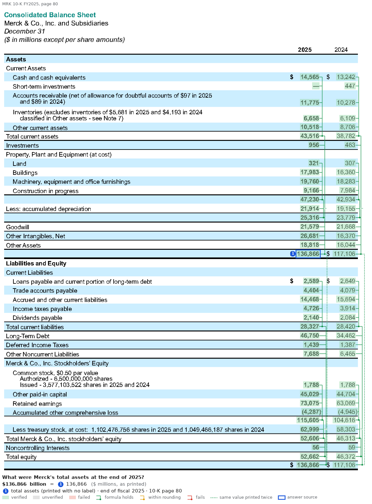
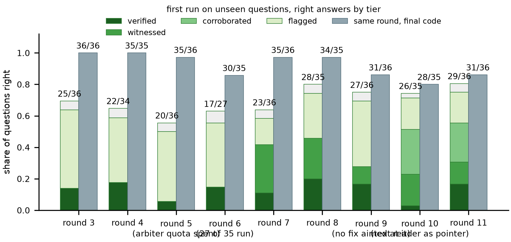

# TieOut

Questions about SEC filings, answered from the filing's own arithmetic and checked by a second method that reads the text. Every answer comes with the page and the printed number behind it, and a tier that says how far to trust it.

[[HEADLINE]]

## The idea: a filing is a spreadsheet whose formulas were erased

TieOut recovers the formulas from the printed numbers alone, with no model and no XBRL. A subtotal is the sum of the lines above it, in every period column. A total column is the sum of the segment columns. The same figure printed in two tables ties. Last year's column must equal last year's report. Those equations are the graph. They verify a number, solve for a number printed nowhere, name a row by its place in the arithmetic, and explain why a figure changed between two filings. Every other table row and every numeric sentence is a node with a value, a unit, a period and a page, linked to a question when a question needs it.



*Merck's balance sheet (10-K page 80), drawn by `python -m tieout show`. Green brackets are recovered formulas. The answer cell is outlined in blue.*

## How a question is answered: two roads

**The plan road (structure).** A language model compiles the question into a typed plan in a small plan language (`benchmark/plan_language.txt`: get, calc, compare, rank, filter, series, members). It never sees a figure. A deterministic executor runs the plan on the graph and returns the answer with its proof leaves (filing, page, printed text), or an abstention that names the fact it could not find.

"What were Apple's net sales in the fourth quarter of fiscal 2026?" No filing prints that number. The plan is one step: get Revenue for fiscal 2026, quarter 4. The executor finds the equation where it is the only unknown: 478,834 for the year (10-K page 28) minus 364,357 for nine months (third-quarter 10-Q page 4) is $114,477 million, and both sources sit inside passing checks.

**The passage road (text).** The graph cannot answer from a line the build never read, or a fact stated only in a sentence that the linker did not find. A plain retrieval pipeline can: passages of the filings, BM25 and dense vectors fused, one model reads them and does its own arithmetic. That pipeline is this repository's baseline. Alone it is right far less often than the plan road, but on different questions. On the first runs of rounds 3 to 9 (240 questions nobody had seen), the plan road was right on 162, the passage reader on 135, and at least one of the two on 203.

So the baseline is kept inside the system as a witness of another kind (`tieout/passage.py`, `readers.second_road`). It is never trusted alone:

| When | What happens |
|---|---|
| The plan road has no answer, and no planner says the filings lack it | The passage answer is served, FLAGGED. If the passage reader cannot answer the whole question, a planner's plan is run on facts read from passages. |
| A reading only one planner holds, which the passage reader repeats | That reading is served. |
| A FLAGGED answer the passage reader repeats | CORROBORATED: two different methods reached it. |
| The passage reader gives a different figure | The served plan is run again on facts read from passages. Only if that run and the passage reader's own answer agree against the graph's figure is the graph overruled: it read a wrong line for a right plan. |
| A VERIFIED or WITNESSED answer the passage reader disputes | The strongest free model plans the question too. Its answer is served if it sides with the passage reader. |

Each rule was simulated on saved results before it was built. One passage reading alone never replaces a served answer: tried on saved results, that lost more answers than it won (`dev_scripts/fable/two_roads_sim.py`). Every result row records what the plan road alone served, so each run reports both numbers.

## Trust: two planners, two pickers, two roads, five tiers

No single model's choice is served as fact. Two planners read each question: a free hosted model and a small model fine-tuned on Kaggle that runs on a laptop CPU. Their plans are compared on what they yield, not on their wording. A stronger model, the arbiter, is called only when they disagree. When an answer needs a printed line outside the three statements, two pickers choose it and are compared on the figure each pick yields. The passage road then checks the result from outside.

The planners and pickers are not independent, and we measured how much that matters. Both pickers are Gemini flash-lite models. The local planner learned from paraphrases the hosted model wrote. When the two planners disagreed (139 cases over rounds 4 to 8), the hosted one was right 80 times, the local one 29, the arbiter 96, and the served answer 100. The passage road is the one witness that shares none of this: it reads text, not plans.

| Tier | What the code promises (`tieout/execute.py` `trust`, `tieout/readers.py`) | Right, [[TIER-SOURCE]] |
|---|---|---|
| VERIFIED | Every number is a statement line bound to its concept by a seed binding (no model chose the row), inside a formula that holds on its page or solved from such numbers. Two planners read the question alike. | [[T-VERIFIED]] |
| WITNESSED | The same, except some lines were chosen by models, and each such choice was made by two models that agreed. | [[T-WITNESSED]] |
| CORROBORATED | An answer with a weakness (one model's choice, a line outside any formula) that the passage road repeats, or one where the arbiter and the passage road agree. | [[T-CORROBORATED]] |
| FLAGGED | Answered, with each weakness named, and the passage reader's different answer printed beside it when there is one. | [[T-FLAGGED]] |
| ABSTAIN | Not answered. Says what is missing. | [[T-ABSTAIN]] |

## The configuration

The headline runs on what the brief allows: one free Gemini key and a laptop CPU. Planner `gemini-3.5-flash-lite` (plans and picks). Second planner `tieout-planner-4b-v3`, our fine-tuned Qwen3-4B, through Ollama on the CPU. Second picker `gemini-3.1-flash-lite`. Arbiter `gemini-3.6-flash`, then `3.5-flash`, then `3-flash-preview`. Passage reader `gemini-3.5-flash-lite` over a hybrid retriever (BM25 plus `bge-small` vectors on the CPU). One command runs it (`dev_scripts/fable/heldout_c.sh`).

Paid models were used for development throughput and for one question only: is the model the bottleneck? That answer is its own table below. No paid number is mixed into a free one.

## Held-out results (run once, after the freeze)

[[HELDOUT]]

## The centre of this work: we measured our own overfitting

Development numbers flattered the system: 84 of 87 on the first development set, 56 to 69 percent on questions nobody had seen. So the work ran in rounds. Blind authors (agents that read only the filings and the list of questions already used) write a fresh round. A leak gate drops near copies of held-out questions without anyone reading them. The system runs once, and that first run is recorded before any answer is read. Only then are the misses fixed, by class. The round then becomes development material.

[[ROUNDS-TABLE]]



[[ROUNDS-TEXT]]

Part of the gap is adaptation to development questions. Part may be that fresh questions are harder or different: Recht et al. (2019) measured a similar drop on fresh ImageNet test sets with no reuse at all. We report both numbers and do not call the gap overfitting alone. The scorer changed during the work (six rules were relaxed on 22 November after misses were read, then tightened against a red team's counter-examples), so every headline number is given under the final scorer and under the strict scorer of 21 November.

**A negative result we keep.** The system stores links between a question's words and a printed line when the answer they led to was right. We expected that store to help on new questions. It did not: round 8 scored 30 of 35 with the links learned on rounds 1 to 7 and 30 of 35 without them, because only 3 of its 35 questions touch a stored pair. The store helps a question that is asked again, not a new one.

## Is the model the bottleneck? (paid side experiment)

| Setup | Round 7, 36 questions (development by then) | Round 9, 36 questions (first run, unseen) |
|---|---|---|
| Baseline: passages, flash-lite reads | 20 | 17 |
| flash-lite alone on the graph (one planner, one picker) | 19 | |
| gemini-3.1-pro alone on the graph (paid) | 22 | |
| The free setup: two planners, two pickers, arbiter | 31 | 27 |
| Scaled: Claude Sonnet 5.5 plans and picks, gemini-3.1-pro arbitrates (paid) | 32 | 26 |

All on the code of 22 November, before the second road; round 9 as scored that night (26 and 26 under the final scorer). A stronger model alone gains 3 questions. The design gains 12. Paid models inside the design gain one question on a development round and lose one on unseen questions. On 145 clean row-pick pairs, six models of four families all pick the right row 68 to 73 percent of the time (`dev_scripts/fable/pick_models*.log`). The model is not the bottleneck; a second method was worth more than a stronger model, which is why the last night went into the second road.

## Where it fails, by class

[[FAILURES]]

## Every printed number is a node or a listed gap

A question about a line the build never read gets a confident wrong neighbour. So the graph keeps a ledger of what it failed to read (`scripts/ledger.py`). Every number on every page of the text layer is tokenised. Years, dates, footnote markers, page numbers and references are set aside, and each remaining quantity is matched to a node on the same page. What no node holds is written to `graph/residue.json.gz` with its line, the lines around it and a class.

`python scripts/ledger.py --ticker HD --page 37` prints one page's certificate; `results/ledger.csv` has one line per filing. Over the 55 filings: 231,273 printed quantities, 199,791 held by a node (86.4 percent); in the body of the filings, outside tables of contents and exhibits, 191,087 of 217,132 (88.0 percent). The 26,045 body numbers not held are listed by class. Matching each page against the nodes of another page of the same filing holds 2.8 percent, so a match by value is rarely a coincidence. The ledger reads the same text layer as the build, so the certificate can say "listed" but never "complete".

The ledger found three build cases the loss analysis had left open, each fixed as a class with a test (`tests/test_buildfix4.py`): a chain of footnote markers that hid a row's figures (Home Depot, average ticket), a quarterly table inside a 10-K whose header read as prose (Bank of America, 400 undated figures), and a caption broken over three lines that lost its scale (JPMorgan, 13 rows read as per-share amounts). Against the previous graph: 46 table lines gained, none lost, and the SEC-keyed scale test unchanged at 8,083 right, 0 unverified wrong, 67 silent wrong out of 8,667.

Two further uses were measured and not merged. A vision model laid out the tables of the 13 pages with the most residue; a cell was accepted only if its number is in the text layer and a row only if it restores a footing equation. 318 of 445 proposed rows were accepted and 935 of 1,337 unread numbers recovered; with the numbers shuffled within each page, 100 seeds accepted no row (`vision_lab/REPORT.md`). And of 7,689 footing checks, 64 fail; one unread line of the same page completes 4 of them, 2 by coincidence (`results/complete_by_arithmetic.json`).

## What did not work

- Tuning on one development set: 84 of 87 there, 56 to 69 percent on fresh questions.
- Trusting one model's plan or pick. Flash-lite slips on about one plan in eight and often picks a look-alike row.
- A stronger model alone, or a picker of another family: see the side experiment above.
- Letting the passage reader replace a served answer whenever it disagrees: 141 of 178 right on saved results, against 144 when it may only fill, break ties and corroborate.
- A word rule for "how much did X grow" (the rate or the amount?): the keys of blind authors want the rate in 2 development questions and the amount in 2, so the rule was removed after its red team.
- A reverse check of a picked row (a model shown only the row's place says what it reports), and a third cheap planner of another family: neither gained on rounds 7 and 8, and the first promoted a wrong answer.
- The link store on new questions (above).
- Relaxing a scoring rule after reading a miss without a counter-example test. The red team found a wrong answer that passes each of the six rules relaxed on 22 November, hence the strict scorer.
- Distant supervision of a row picker by numeric equality: of 1,790 training pairs, 805 were coincidental ties.
- A model judge for admitting a binding: 97.0 percent precise, but it threw away 34 of 66 right proposals (`results/judge_vs_gate.json`).
- Fine-tuned planners trained on template questions only: 84 to 88 percent exact on synthetic phrasings, 64 to 68 of 87 on real ones. Paraphrase training fixed most of it (below).

## The fine-tuned models

Planners fine-tuned on Kaggle GPUs from Qwen3 (LoRA, one epoch, plans written in the plan language for templated questions, paraphrased by the hosted model and drift-checked, leak-checked against the held-out questions). Published with cards that state data, method, scores and limits: [4B v3](https://huggingface.co/Madhvansh/tieout-planner-qwen3-4b-v3-gguf) (the second planner of the configuration), [4B v2](https://huggingface.co/Madhvansh/tieout-planner-qwen3-4b-v2-gguf), [1.7B v3.1](https://huggingface.co/Madhvansh/tieout-planner-qwen3-1.7b-v3.1-gguf), [1.7B v2](https://huggingface.co/Madhvansh/tieout-planner-qwen3-1.7b-v2-gguf), [0.6B v2](https://huggingface.co/Madhvansh/tieout-planner-qwen3-0.6b-v2-gguf). Alone, on rounds 1 to 5 (194 questions): v2 4B 137, v3 4B 152, flash-lite 175. A v3.2 retrain on eight newer plan forms had its success criteria written before training (5 more right answers on rounds 6 to 8). It missed them: 52 of 106 for both v3.2 and v3 on the same machine, so v3 stays. [[8B]]

## What I would do next

Each of these was built or measured and stopped short of the frozen system. The number is what was measured.

- **Run rankings and comparisons on passage facts too.** The plan re-run on passage facts handles get, calc and change steps. Rankings and comparisons of several companies are where the passage reader alone is weakest and the vote is missing.
- **Periods as intervals.** A twelve-month period that is not the fiscal year, or a quarter restated in a later table, still fails (Bank of America's restated third quarter, round 7). Start and end dates for every column, a quarter as interval subtraction.
- **Wire the page-image rows into the graph.** 318 rows accepted by arithmetic on 13 pages. Left out because a label is not proven by arithmetic: two operands that trade labels keep every sum.
- **Read award and option tables.** Share counts there are read as dollars in the money scale. A fix was built and switched off: its red team found the share scale wrong on 11 pages.
- **Show the unread lines when nothing fits.** The ledger knows which printed lines of a page no node holds; they could be listed as FLAGGED candidates.
- [[NEXT-EXTRA]]

## Run it

Python 3.12, no GPU, no key. The built graph, every model call and every passage reply are in the repository, so the reported runs replay offline:

```
pip install -r requirements.txt
[[REPLAY]]
python -m tieout ask --offline "What were Apple's net sales in the fourth quarter of fiscal 2026?"
python scripts/ledger.py --ticker HD --page 37
```

A new question needs the local model (Ollama on the CPU) and a free key. Rebuild from the PDFs: `python scripts/fetch_corpus.py`, `python -m tieout build`, `python scripts/build_raw.py`, `python scripts/add_headings.py`, `python scripts/ledger.py`. `python scripts/clean_clone_check.py` clones the repository into a fresh folder and runs the checks (`results/clean_clone_check.json`).

## How I used AI

The brief says to use AI tools freely and to say how. The AI (Claude Code: several sessions of Claude Opus 5.5 and Claude Fable 5.2, with Sonnet sub-agents for narrow lanes) wrote all of the code in this repository, ran every experiment and drafted this README and the results PDF. Agents that could read only the filings wrote the benchmark questions; other agents, blind to the answers, re-derived the gold; red-team agents attacked each change before it was kept. Hosted models read questions inside the system (Gemini flash-lite and flash); the paid side experiment used Gemini 3.1 Pro and Claude Sonnet 5.5. I set the direction and made the rulings, recorded as they were made in `DECISIONS.md`:

1. **Design (D1).** Take the most ambitious design and drop nothing for being hard: the recovered-formula graph fused with a layer that learns from questions behind an admission gate, general rather than tuned to a few companies.
2. **Corpus (D2).** About forty latest 10-Ks across sectors with the banks included, the prior-year 10-K for ten of them so restatements show up, and a few 10-Qs so a quarter printed nowhere can be derived.
3. **Fine-tuning (D3).** The literature survey and the red team advised against it. I overruled them: a small local model is fine-tuned to write plans, so the system has a second reader that needs no key.
4. **Name (D4).** TieOut.
5. **AI use (D5).** The take-home uses AI openly and says how; the interview is mine alone.
6. **Resources (D6, D12).** I set up the keys and accounts; extra keys are for development only, so the reported run fits one free key.
7. **Publication (D7).** Push the public repository.
8. **No checks by hand (D8).** Checks are automated passes, and this README says so.
9. **Stop and revamp (D9, D10).** I stopped the first version and ordered a red team of everything it claimed, written failures, and a revamp rather than a patch. On the last night I ordered a second revamp for real gains on unseen questions; the second road came out of it.
10. **The target (D11).** Accuracy on questions nobody has seen, not on development: the reason for the fresh rounds above.
11. **Research before training (D13).** The lab's plan was to start GPU runs at once. I overruled it: research first, success criteria written before any run, no blind training.
12. **The learning layer stays (D14),** with a second witness before a link is trusted and a way to withdraw it.
13. **Do the hard thing (D15).** Difficulty and time are not reasons to drop an idea.

Two of these overruled the plan the AI had put to me: fine-tuning (D3) and research before training (D13). On rules: every rule in the code is written for a class of page or question and has a test. Three began as one company's miss and were rewritten for their class: counted nouns in sentences (Costco's leases, UnitedHealth's scripts), a column the question names outranking the Total column (Exxon's reserves), and the audit of look-alike rows (Oracle's debt schedule).

## Repository map

```
tieout/        the package: pdfio, tables, alltables, statements, calc, graph (build); rawlayer, mentions (every
               other table and sentence); concepts, living, link (names and links); plan, planner, readers,
               witness, execute, ask (the plan road); passage (the second road); restate; eval/
baseline/      the retrieval pipeline: the baseline, and the reader of the second road
benchmark/     every round's questions, the plan language, hand-written plans
scripts/       build, ledger, evaluate, audit, scale test, coverage, figures
results/       every result file the numbers above come from
graph/         the built graph, the raw layer, sentence records, the ledger's residue
semantics/     seed concepts as data, learned links, absence facts
finetune/      data builders, Kaggle scripts, model cards
cache/         every model call and passage reply, so results replay offline
report/        the two-page results PDF and its figures
```
